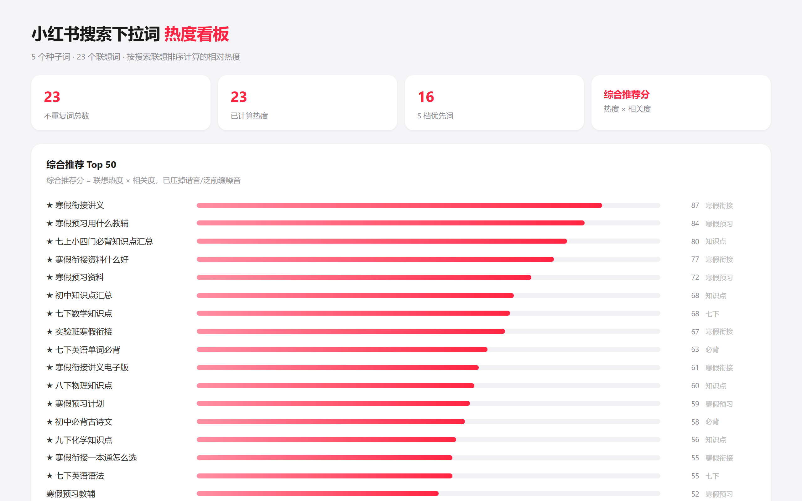
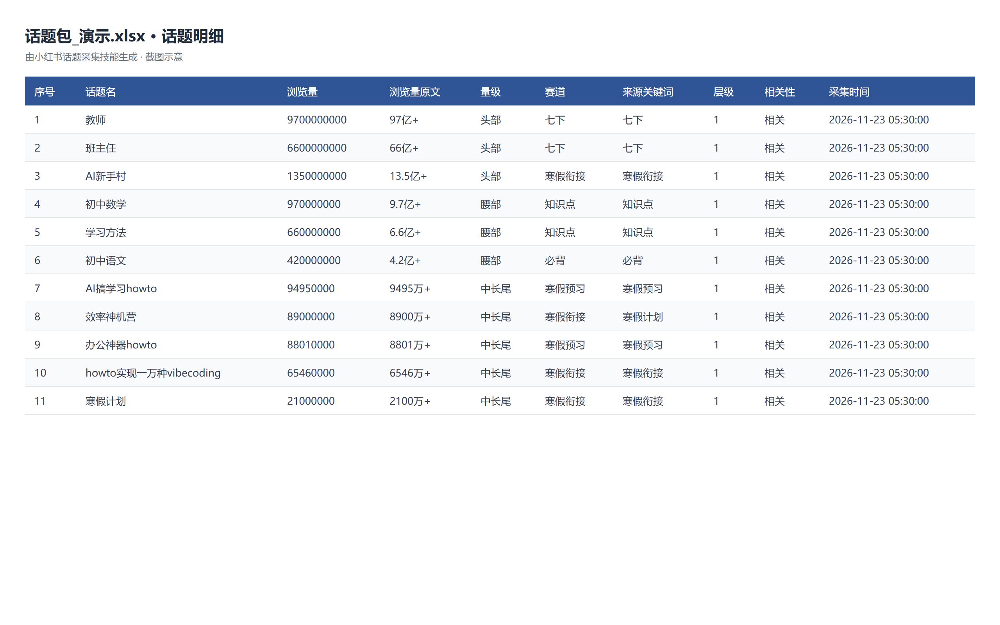

# 小红书搜索流采集工具包

> 一套跑在小红书真实搜索框上的采集工具：**关键词挖掘** + **话题采集**，双件套配合使用，从"搜什么词"到"配什么话题"一次打通。



## 这是什么

做小红书搜索流量最头疼两件事：**不知道该埋什么词**、**不知道该配什么话题**。这套工具把两件事都变成可执行的数据：

| 工具 | 干什么 | 产出 |
|---|---|---|
| [**xhs-keyword-miner**](xhs-keyword-miner/) · 关键词采集 | 逐字输入触发真实搜索下拉联想，算热力分、按 S/A/B/C/D 分层 | Excel 明细（7 表）+ 可上传词包 CSV + 交互式看板 |
| [**xhs-topic-harvest**](xhs-topic-harvest/) · 话题采集 | 从发布页话题联想采集官方话题库，自动归赛道、判相关性 | 话题包 Excel（总览/明细/优先级/蓝海机会）+ 标签库导入 CSV |



## 标准用法：先挖词、再配话题

```
第 1 步  关键词采集  →  确定主攻词 + 占位词（S/A 档优先投入）
第 2 步  话题采集    →  给每篇笔记配官方话题，建立账号标签
第  3 步  排期发布    →  一词一帖、标题埋词、锁人群爬坡更新
```

## 快速开始

### 方式一：装进 WorkBuddy（推荐）

把两个文件夹打 zip 后，在 WorkBuddy 客户端「技能库 → 上传技能」导入即可，之后对话里直接说"帮我挖小红书关键词"就能调用。两个技能也已上架 [SkillHub 技能市场](https://www.skillhub.cn)，搜索作者「疯狂的姜柠檬」可直接安装。

### 方式二：其他 AI Agent（Codex / Claude Code / Cursor 均可）

工具本体是「Python/Node 脚本 + Markdown 说明」，不绑定 WorkBuddy。任何有代码执行能力的 Agent 都能用：

- **Claude Code / WorkBuddy**：自动识别 `SKILL.md`，直接说"帮我挖小红书关键词"即可
- **Codex / Cursor**：仓库根目录已提供 [`AGENTS.md`](AGENTS.md)，打开会话后说"读 AGENTS.md，按说明采集××关键词"即可，Agent 会自行读文档、装依赖、跑脚本

### 方式三：独立脚本运行

**关键词采集**（依赖 Python 3.10+、Playwright、系统 Chrome）：

```bash
cd xhs-keyword-miner/scripts
python miner.py --seeds "寒假衔接,寒假预习,知识点"   # 采集
python export.py --workdir ./xhs_keywords           # 导出词包+看板
```

**话题采集**（Node 18+，经 CDP 通道驱动浏览器）：

```bash
cd xhs-topic-harvest/scripts
node crawl.mjs    # 采集话题联想
python build.py --input ./out --xlsx 话题包.xlsx --csv 总表.csv
```

完整参数与字段说明见各自目录下的 `SKILL.md` 和 `references/`。

## 输出文件长什么样

`examples/` 目录里有用样例数据跑出来的完整产物，可直接打开看效果：

- `小红书关键词明细.xlsx` — 7 个 sheet：总表 / 按种子汇总 / 核心下拉 / 前缀扩散 / 二级扩展 / 热度排行 / 指标说明
- `小红书关键词看板.html` — 浏览器打开即用的交互看板
- `关键词包_精选.csv` — S/A 档纯词单列，可直接导入投放平台
- `话题包_演示.xlsx` — 总览 / 话题明细 / 选题优先级 / 蓝海机会 / 标签库导入

## 数据口径（重要）

工具输出的是**「联想热力指数」**——基于搜索建议排序的相对值（出现次数广度 × 联想平均名次加权），**不是小红书官方搜索量**。需要权威月搜索量请到聚光平台「关键词规划工具」查询。采集请控制频率（脚本内置 3-8 秒随机间隔），遵守平台规则，仅供个人运营研究使用。

## 作者

**疯狂的姜柠檬**

- SkillHub 技能市场：搜索「疯狂的姜柠檬」，本工具包已上架（支持在线安装）
- 公众号：**疯狂的姜柠檬** —— 持续更新小红书搜索流打法、起号排期方法论、AI 工具实操教程
- 更多问题欢迎公众号留言交流

---

© 2026 疯狂的姜柠檬. 本项目为原创作品，保留所有权利。详见 [LICENSE](LICENSE)。
